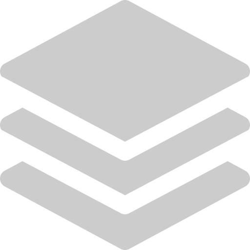

<div align="center">
  

  # Omnicraft

  **A curated resource hub for web designers and developers**

  Discover vetted UI libraries, icons, and developer tools built with Next.js and MongoDB.
</div>

## Why Omnicraft?

Design assets, icon packs, and UI libraries are scattered across hundreds of bookmarks. Omnicraft solves resource fragmentation by consolidating vetted web tools into a single searchable platform, giving you a reliable starting point for anything from minimal landing pages to full web applications.

## Key Features

- **Curated Resources:** Handpicked selection of icons, UI libraries, and design elements.
- **Structured Categories:** Organized collections and tags for fast filtering.
- **Focused Interface:** Clean, distraction-free UI built for quick browsing.
- **Saved Favorites:** Bookmark tools locally for quick access.

## Tech Stack

- **Framework:** Next.js 16, React 19, TypeScript
- **Styling & Motion:** Tailwind CSS v4, Motion
- **Database:** MongoDB Atlas
- **Hosting & Analytics:** Vercel, Vercel Analytics
- **Tooling:** Oxlint, Oxfmt, pnpm

## Getting Started

1. Clone and install dependencies:

   ```sh
   git clone https://github.com/fahadshahbaz/omnicraft.git
   cd omnicraft
   pnpm install
   ```

2. Configure `.env.local` using `.env.example`, then start the dev server:

   ```sh
   pnpm dev
   ```

## Live

[omnicraft.vercel.app](https://omnicraft.vercel.app)

## License

MIT
